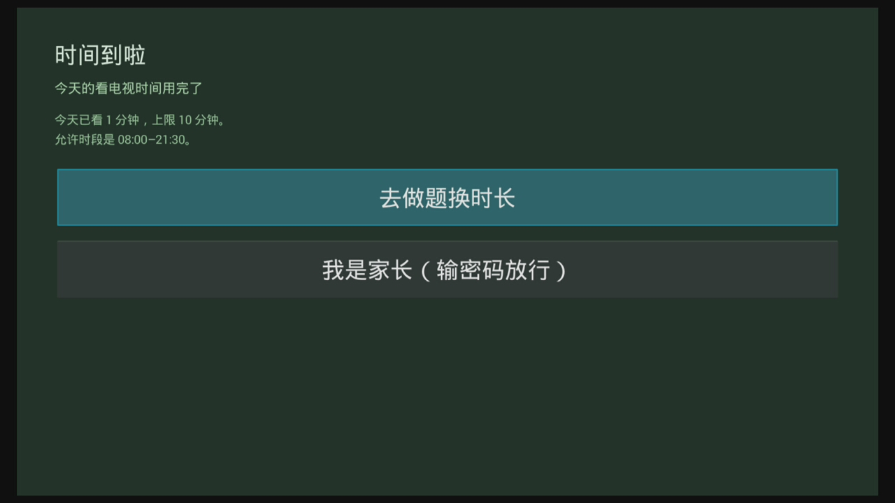
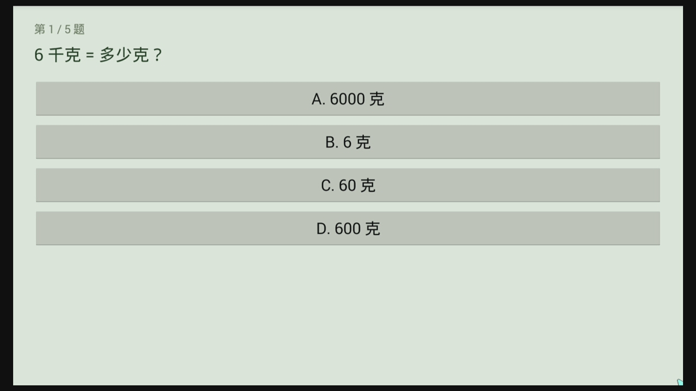
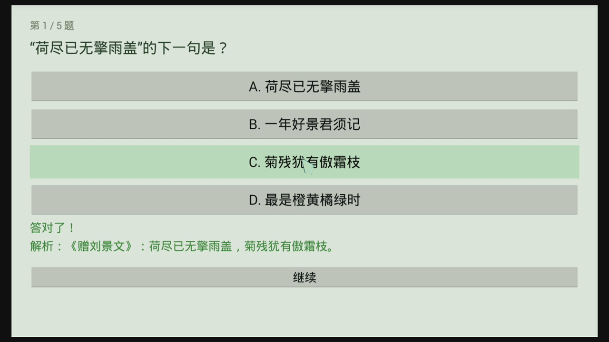
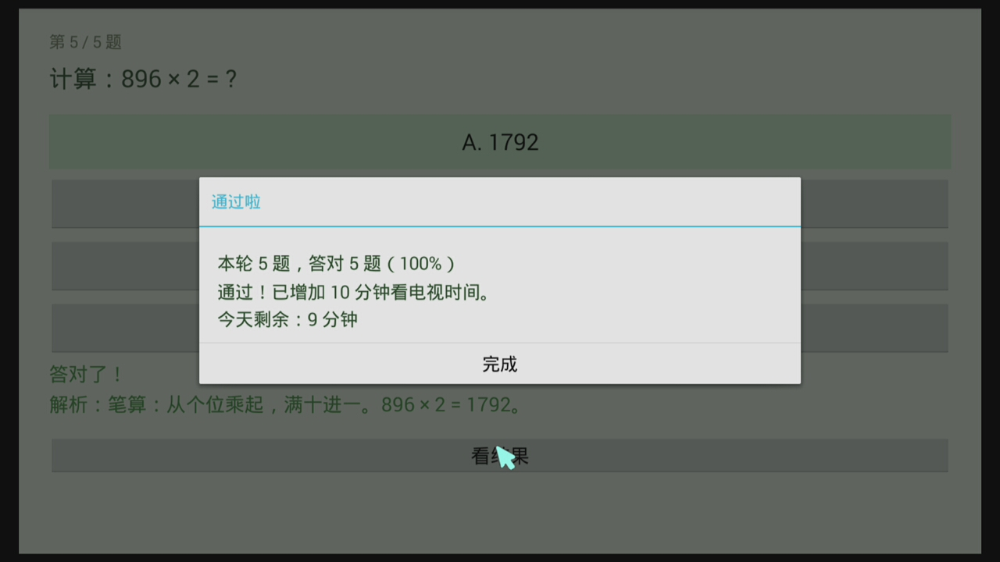
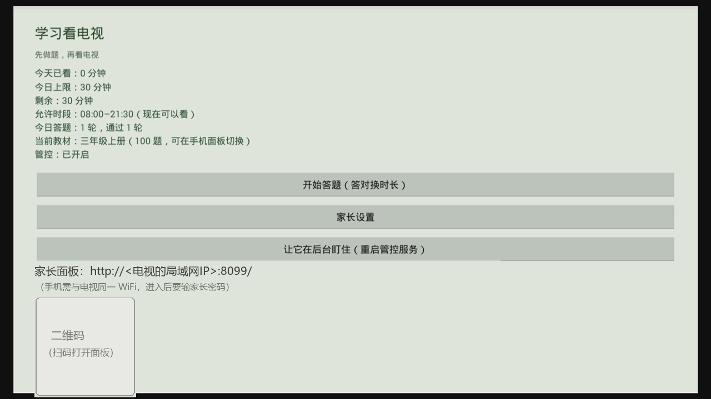

# 学习看电视（KidTV Guard）

给 **老安卓电视盒子** 做的一款「先答题、再看电视」的家长管控 App：每天限定看电视的时长和时段，时间用完就弹出全屏拦截页，做题可以换额外时长，家长用密码随时放行。

> **这个项目存在的意义只有一个：补老机型的空白。**
> Android 7 以上的新盒子、新电视，已经有成熟的开源方案（例如 [chadyi/StudyonTV](https://github.com/chadyi/StudyonTV)），功能和界面都比我这个完善，**新设备请优先用它们**。
> 但 2014–2016 年前后的那批 Android 4.4 / 5.x 运营商 IPTV 盒子、老电视、老投影，跑不动那些项目：系统 WebView 太老、按钮点不动、界面糊成一团。本项目就是为这类机器重写的：**全部用原生 View，不依赖 WebView、不依赖 TTS 引擎、不依赖新 API**，在 Android 4.4 上实测可用。



## 它解决什么问题

| 你的设备 | 建议 |
|---|---|
| Android 7 及以上（新电视、新盒子、电视投影） | 用 [StudyonTV](https://github.com/chadyi/StudyonTV) 等成熟项目，别用这个 |
| Android 4.4 / 5.x 老盒子（跑那些项目时 WebView 白屏、按钮点不动） | 用本项目 |
| 想要「做题换时长 + 手机遥控 + 分年级题库」但机器太老 | 用本项目 |

## 功能

- **每日时长 + 允许时段**：默认每天 30 分钟、只在 08:00–21:30 可用，时段外一律拦截。
- **到点全屏拦截**：不在白名单的应用一打开就被顶掉，弹出「时间到啦」页，只有两个出口——「去做题换时长」和「我是家长（输密码放行）」。
- **答题换时长**：一轮 5 题，答对 80%（4 题）加 10 分钟；答错当场显示正确答案和解析，语音鼓励。
- **按键锁**：答题页、拦截页按返回键不放行，按主页键会被后台服务 1 秒内拉回（进度不丢）；家长可用「4 秒内连按 5 次返回 + 密码」退出。
- **家长面板（手机）**：手机连同一个 WiFi，扫码或打开 `http://<电视IP>:8099/`，输密码后改规则、切教材、远程放行、改密码。电视 IP 变了地址和二维码会跟着变。
- **分册题库**：小学 1–6 年级上/下册共 12 册，每册 100 题（数学 50 + 语文常识 50，数学按苏教版单元顺序），面板一键切换。
- **语音提示**：答对/答错/通过/未通过 5 段中文语音，打包在 App 内（老盒子一般没有中文 TTS，所以不用系统引擎）。

| 答题页 | 答对 | 通过 |
|---|---|---|
|  |  |  |



## 它是怎么工作的

只有一个前台服务 + 三个界面，全部是原生 View：

1. `GuardService` —— 常驻前台服务，**每秒** 用 `ActivityManager.getRunningTasks(1)` 看一次当前前台包名。前台包名不在白名单里就开始累计使用时长；时间用满或不在允许时段，就直接拉起拦截页。
2. `QuizActivity` —— 答题页，判对错、显示解析、播语音，通过后写 `bonusMin` 并把用户送回原来的视频 App（不用重开）。
3. `BlockActivity` —— 全屏拦截页，同时写入"拦截锁"，服务发现前台不是这一页就把你拉回来（这就是 HOME 键跑不掉的原因）。
4. `HttpPanel` —— 内置的极简 HTTP 服务（端口 8099），提供网页面板和 JSON 接口，手机在同一局域网即可管理。

数据都存 `SharedPreferences`（`kidtv.xml`），题库是 `assets/bank/*.json` + 运行时可被覆盖的导入文件。

## 安装

1. 下载 [Releases](../../releases) 里的 `kidtv-guard-v1.9.apk`。
2. 电视打开「设置 → 关于 → 连点版本号」开启开发者模式，再打开 **USB/网络调试**（不同厂商路径不一样，有的在「设置 → 更多设置 → 开发者选项」）。
3. 用 adb 安装（盒子一般允许 `adb connect`）：

```bash
adb connect <盒子的局域网IP>:5555
adb install -r kidtv-guard-v1.9.apk
adb shell monkey -p com.kidtv.guard -c android.intent.category.LAUNCHER 1
```

也可以把 APK 拷到 U 盘，用盒子自带的文件管理器安装（部分厂商盒子禁止第三方安装，需要先在设置里放开）。

首次启动会让你设置家长密码（默认示例是 `123456`，**请自己改掉**）。

## 第一次用必须改的两处

**1）家长密码**：面板里点「修改家长密码」。

**2）白名单（最重要，每个人的机器都不一样）**：默认白名单只是几个常见桌面的示例，形如：

```
<桌面包名>, <桌面包名2>, <系统设置包名>, com.android.systemui,
com.android.settings, com.android.providers.tv, com.android.providers.settings
```

**你的盒子桌面基本不会正好在这份列表里**（当贝、halotv、小米、创维、TCL、各运营商定制桌面包名全都不一样），不改的话会被当成"在看电视"一直计时，甚至把桌面本身拦掉。

先查自己盒子的桌面包名：

```bash
adb shell "dumpsys activity activities | grep mFocusedActivity"   # 老系统
adb shell "dumpsys window | grep mCurrentFocus"                   # 另一种写法
```

看到类似 `mFocusedActivity: ActivityRecord{... u0 com.xxx.launcher/.MainActivity ...}`，把 `com.xxx.launcher` 那个包名填进面板的白名单输入框（逗号分隔），保存即可。

同理，**设置类、系统 UI 也建议加进白名单**，否则家长进设置也会被拦。

## 家长面板

| 入口 | 能力 |
|---|---|
| 电视首页「家长设置」 | 改时长/时段/题量/及格线/奖励、改密码、恢复本册原题、今日用量清零、临时放行 |
| 手机 `http://<电视IP>:8099/` | 上面全部 + 切换教材 + 远程放行 10/30 分钟 + 导入题库 |
| 电视首页二维码 | 手机扫码直达面板（IP 变化后二维码自动更新） |

主要接口（密码放请求头 `X-Pwd`）：

| 接口 | 说明 |
|---|---|
| `GET /api/state` | 读状态（含 `bankCount`、`ip`、`panelUrl`、`book`、`bookName`、`books`） |
| `GET /api/books` | 教材清单 |
| `POST /api/book` | 切教材 `{"id":"m3a"}` |
| `POST /api/config` | 改规则 `{"daily":30,"ws":"08:00","we":"21:30","qc":5,"pass":80,"reward":10}` |
| `POST /api/bank` | 导入题库 `{"json":"..."}` |
| `POST /api/resetbank` | 恢复当前册原题 |
| `POST /api/clear` | 今日用量清零 |
| `POST /api/unlock` / `POST /api/relock` | 远程放行 `{"min":10}` / 立即恢复管控 |
| `POST /api/pwd` | 改密码 `{"new":"..."}` |
| `GET /qr.png` | 面板二维码（无鉴权） |

## 题库

内置 12 册，每册 100 题，共 1200 题：

| 学科 | 说明 |
|---|---|
| 数学（50 题/册） | 按苏教版单元顺序编排，答案由脚本计算生成，不是手写的 |
| 语文常识（50 题/册） | 识字、古诗、课文常识、生活常识 |

- **正确答案位置是随机打乱的**（A/B/C/D 各约 25%），不是固定 A —— 早期版本曾经全是 A，孩子选 A 就能满分，这个坑已经在 v1.9 修掉。
- 题库 JSON 格式：

```json
{"items":[
  {"q":"9+9=?","a":["17","18","19"],"k":1,"tip":"9加9等于18"},
  {"q":"地球是圆的。","a":["正确","错误"],"k":0}
]}
```

`q` 题干、`a` 选项（2–4 个）、`k` 正确项下标（从 0 开始）、`tip` 解析（可省略）。可以自己替换任意一册。

- `tools/` 下是题库生成器：`gen_math.py`（数学）、`gen_cn.py`（语文）、`assemble.py`（汇总、去重、校验、写 `assets/bank/`）。想改题目或换教材版本，改这三个脚本后运行 `python3 tools/assemble.py` 即可重建全部册。

## 编译

- Android Studio（Gradle 7.4+ / AGP 7.4.2），或命令行 `gradle assembleDebug`；
- `compileSdk 30`、`minSdk 19`、`targetSdk 28`，纯 Java，无 androidx（`android.useAndroidX=false`）；
- 唯一依赖是 `com.google.zxing:core:3.2.1`（生成面板二维码）；
- 记得把 `local.properties` 里的 `sdk.dir` 改成你自己的路径（该文件已在 `.gitignore` 里，不会进仓库）。

```bash
gradle clean assembleDebug
# 产物：app/build/outputs/apk/debug/app-debug.apk
```

## 兼容性与已知限制（请务必读完）

| 限制 | 说明 |
|---|---|
| **不防卸载** | 会进系统设置的孩子可以直接卸载或强制停止。要彻底锁死需要 Device Owner / kiosk，老盒子一般走不通。 |
| **进程被杀后不会自己回来** | 只有开机时由 BOOT_COMPLETED 拉起；可在首页点「让它在后台盯住（重启管控服务）」手动拉回。覆盖安装 APK 后进程会被杀，要重新打开一次 App。 |
| **前台判定靠 `getRunningTasks`** | 在 Android 4.4 / 5.x 上有效（这是本项目能工作的关键）；**Android 7 之后系统只返回自己**，必须改成 `UsageStatsManager` 方案——这也是为什么建议新设备直接用 StudyOnTV。 |
| **HOME 键不是系统级吞掉** | 4.4 的普通应用截不到 HOME，做法是"上锁 + 每秒拉回"，副作用是屏幕上会闪一下再回来。 |
| **锁定 30 分钟自动失效** | 防止异常退出把电视永久锁在页面上；人在页面上时服务会持续续锁。 |
| **只验证过一种机型** | 开发和测试只用了一台 Android 4.4.2、armv7a 的运营商盒子。别的机型能装、能跑的概率很高，但**桌面包名、系统权限行为、HOME 键表现都可能不同**，需要你自己调白名单并试。 |
| **手机面板未做过跨机型渲染验证** | 面板是纯 HTML/JS，接口都验证过；个别老手机浏览器可能有排版差异。 |

## 与其它方案的差异

| | 本项目 | StudyOnTV 类项目 |
|---|---|---|
| 目标机型 | **Android 4.4–5.x 老盒子** | Android 7+ |
| 界面实现 | 原生 View（不依赖 WebView） | 多为 WebView / Compose / 现代控件 |
| 前台判定 | `getRunningTasks`（4.4 可用） | `UsageStats` 等新 API |
| 语音 | 自带 ogg 素材，不用系统 TTS | 依赖系统 TTS |
| 题库 | 12 册 1200 题内置，可换 | 需自行导入 |

## 合规与免责

- 本项目是**家庭自用**工具，用来约束自家孩子看电视的时间，不做分发、不做商业用途。
- 它只做"切前台 + 计时 + 拦截"，**不修改、不破解、不录制任何第三方应用或 DRM 内容**，不涉及任何平台会员权益。
- 安装后请自行确认符合所在地区法律与设备服务条款；因使用本软件造成的设备异常、数据丢失等，作者不承担责任。
- 语音素材由本项目自行生成/打包，若你二次分发请自行确认素材授权。

## License

[MIT](LICENSE)
